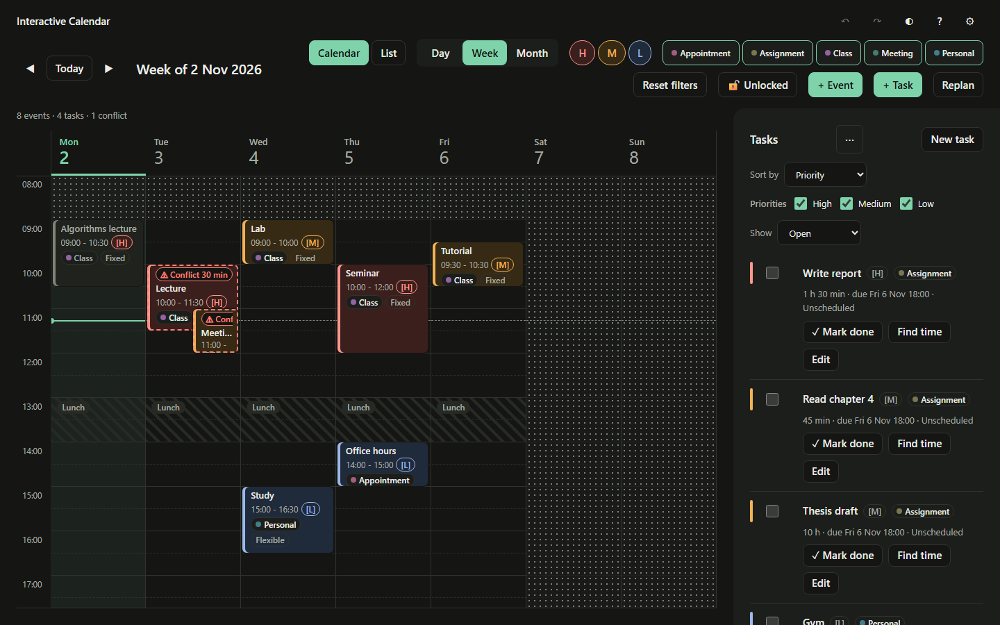

# Interactive Calendar — Feature Creatures

A single-user calendar for CS-3810, by Divyam and Samar. Create, drag and resize events; inspect every overlapping pair; find and explain free time for tasks; compare two replan strategies before applying a change.

**Production URL:** [int-calendarfeature-creatures.vercel.app](https://int-calendarfeature-creatures.vercel.app). The team handles deployment; local work-item status is in [PROGRESS.md](docs/PROGRESS.md).

## Team

**Feature Creatures** · Project 4: Interactive Calendar and Intelligent Time Planner · CS-3810 Design Practices in Computer Science, Ashoka University (Monsoon 2026)

| Member           | Roll number |
| ---------------- | ----------- |
| Samar Baskar     | 1020241699  |
| Divyam Chaudhary | 1020221520  |

## Run locally

Use Node.js 22, matching CI, and npm. From the repository root:

```bash
npm ci
npm run dev
```

Open the local URL printed by Vite. For a production build, run `npm run build`; it writes `dist/`. `npm run preview` serves that build locally. Stop a development or preview server with Ctrl+C when finished.

In Windows PowerShell environments that block npm's `.ps1` wrapper, use `npm.cmd` and `npx.cmd` for the same commands.

## Try the planner

1. Click **Load sample week** on an empty calendar. Later, use **Settings → Data → Load sample calendar** to choose a preset.
2. Create an event with **+ Event** or by selecting empty time. Click an event to edit it; drag to move it, or drag its bottom edge to resize. The event dialog also supports keyboard editing of start and end.
3. Inspect the conflict panel and choose **Suggest alternatives**. Read the proposed slot and its boundaries, then **Apply**.
4. Create a task, choose **Find time**, review its ranked options and apply one. Select several unscheduled tasks to schedule them in a queue; **Skip** leaves a task unscheduled.
5. Open **Replan**, compute the two plans, compare moves and metrics, then apply one. **Undo** reverses the whole applied plan in one step.

The task and conflict panels move into **Tasks and conflicts** below 1024 px. **List** provides a text agenda. The theme button cycles System → Light → Dark; the toolbar **?** button or `?` key opens the shortcut guide. Priorities and conflicts carry text tags as well as colours.

Events can remain inside barred slots. They show **In Lunch** (or the configured label), and **Barred-slot overlaps** lists each overlap with its minutes and an alternatives action. These warnings do not increase event-pair conflict counts or replan metrics. Saving settings that introduces overlaps also shows an info toast; **View** opens/focuses the section.

The sparse-week **Thesis draft** is a 10-hour task. Lunch splits working time into four-hour stretches, so it shows **TaskLongerThanWindow (ER2)**: “This needs 10 h, but the longest stretch available in its window is 4 h.” It does not report **NoSlotFound (ER3)**.

All calendar data stays in the current browser's IndexedDB. Export JSON to back it up. Import and sample replacement replace events, tasks and settings and clear undo history. Undo/redo keeps up to 50 steps in memory and does not survive reload. When storage is unavailable, the app warns that changes will be lost after the tab closes.

## Screenshots

The sample week (**Load sample week**) in both themes:




More views, all generated with `npm run screenshots` from [scripts/screenshots/](scripts/screenshots/screenshots.spec.ts):

Dialog form captures at 1440 / 1024 / 900 px are in `docs/screenshots/event-dialog-{light,dark}-{width}.png` and `task-dialog-{light,dark}-{width}.png`: [Event light](docs/screenshots/event-dialog-light-1440.png), [Event dark](docs/screenshots/event-dialog-dark-1440.png), [Task light](docs/screenshots/task-dialog-light-1440.png), [Task dark](docs/screenshots/task-dialog-dark-1440.png).

Replan explanations for fixed events still in Lunch: [light desktop](docs/screenshots/replan-not-moved-light-1440.png), [dark desktop](docs/screenshots/replan-not-moved-dark-1440.png), [light drawer width](docs/screenshots/replan-not-moved-light-900.png), [dark drawer width](docs/screenshots/replan-not-moved-dark-900.png).

| Scene                       | Light                                                       | Dark                                                      |
| --------------------------- | ----------------------------------------------------------- | --------------------------------------------------------- |
| Week at 1024 px             | [week-light-1024](docs/screenshots/week-light-1024.png)     | [week-dark-1024](docs/screenshots/week-dark-1024.png)     |
| Slot picker (Find time)     | [slot-picker-light](docs/screenshots/slot-picker-light.png) | [slot-picker-dark](docs/screenshots/slot-picker-dark.png) |
| Replan, both plans computed | [replan-light](docs/screenshots/replan-light.png)           | [replan-dark](docs/screenshots/replan-dark.png)           |
| Empty state                 | [empty-light](docs/screenshots/empty-light.png)             | [empty-dark](docs/screenshots/empty-dark.png)             |

Single-theme scenes: [Month view (light)](docs/screenshots/month-light.png), [List view (dark)](docs/screenshots/list-dark.png), [the whole side column with conflicts (light)](docs/screenshots/side-panels-light.png) and [the Tasks and conflicts drawer at 900 px (light)](docs/screenshots/drawer-light-900.png).

## Tests

The algorithms carry the project's correctness claim, so they are tested hardest:

- hand-computed cases with exact expected values
- brute-force oracles compared against the fast algorithms on thousands of random inputs (fast-check)
- coverage gates

The engine is tested through its facade with both storage adapters. The UI is tested against the real engine, never a mock, and Playwright drives real dragging, resizing and the main flows in Chromium, on both the production build and a StrictMode dev server. CI (`.github/workflows/ci.yml`) runs the gate on every pull request and push to `main`, plus the browser suite on `main`.

**Results** (local, 2026-10-26, after WI-38):

| Check | Result |
| --- | --- |
| Unit, integration, property and UI tests | 578 passing (T15 opt-in) |
| Property oracles (T12, T33–T36) | 5 properties × 10,000 random cases, all passing (full run in WI-36; CI runs 1,000 at seed 42) |
| DST suite (America/New_York) | 7 passing |
| Browser checks (Playwright, Chromium) | 18 passing |
| Coverage, overall | 98.55% lines, 93.98% branches (gate: 70%) |
| Coverage, algorithms | 99.70% lines, 95.93% branches, 100% functions (WI-36; gate: 90%) |
| Performance, T15 | 5,000 events, 183 conflicting pairs, median 4.188 ms for sweep + slot search (target < 100 ms) |
| Production rehearsal | Demos D1–D5 passed on the live site; contrast and screen-reader announcements checked |
| Independent audit | Findings A01–A10 re-verified, then fixed test-first or deferred with reasons ([AUDIT.md](docs/AUDIT.md)) |

**Where the full test data lives:**

- [TEST_PLAN.md](docs/TEST_PLAN.md):
  - every case with its exact inputs and expected outputs (T1–T40, E1–E4 and the smoke flow)
  - requirement traceability (§3)
  - manual checklists (§7)
  - demo scripts with the production rehearsal record (§8)
  - release checklist (§9)
- [PROGRESS.md](docs/PROGRESS.md): the gate result recorded for every work item, plus milestone summaries.
- Generated locally, git-ignored:
  - `coverage/index.html`, from `npm run test:coverage`
  - Playwright results, from `npm run e2e`; they print to the terminal, and failure traces land in `test-results/`

**To reproduce:**

```bash
npm run typecheck
npm run lint
npm test
npm run test:coverage
npm run test:dst
npm run test:props:full
npx playwright install chromium
npm run e2e
npm run test:perf
npm run bench
npm run build
```

`npm test` sets `TZ=UTC`. `test:dst` uses America/New_York. The normal property suite uses 1,000 cases with seed 42; `test:props:full` runs 10,000 cases per property with random seeds. Playwright starts its own build/preview server and uses fresh browser storage with the clock fixed to the test week. It checks conflicts, real pointer drag/resize, reload persistence, task scheduling and keyboard/accessibility workflows.

Coverage gates require 90% across algorithm lines, branches, functions and statements, and 70% overall. Manual production checks, including a live screen-reader pass, remain in [TEST_PLAN §7](docs/TEST_PLAN.md#7-manual-checklists-run-on-the-production-url-before-each-milestone).

## Performance (T15)

`npm run test:perf` measures eleven runs of a full conflict sweep plus one facade slot search. `npm run bench` prints the Vitest report. Both use 5,000 events over 100 weeks from `mulberry32(7)` and a 60-minute task over the first four weeks. Generation, validation and engine initialization finish before timing begins.

Local Windows measurement on 2026-10-26 after WI-32/33: **183 conflicting pairs**, eleven-run median **4.188 ms**, against a target below **100 ms** (measured alongside other validation). The earlier WI-28 run measured 1.201 ms; its separate Vitest benchmark reported a **0.2665 ms mean**. The benchmark runner reports module-export getter overhead; these are local test-runner measurements and vary with hardware, JIT warmup and background load.

## Architecture and limits

| Layer                                      | Responsibility                                                                                                              |
| ------------------------------------------ | --------------------------------------------------------------------------------------------------------------------------- |
| React + FullCalendar + zustand             | Render snapshots, collect gestures/forms and explain options; FullCalendar does not decide scheduling                       |
| Engine facade                              | Validate external inputs, serialize commands, update history and run the CRUD, task, alternatives and replan pipelines      |
| Pure algorithms                            | Heap sweep for every overlap pair; merged busy blocks, allowed segments and free gaps; ranking and greedy replan heuristics |
| Repository interface                       | Interchangeable Dexie/IndexedDB and in-memory adapters with atomic changes                                                  |
| Shared types, Zod schemas and time helpers | Domain contracts and local-time boundaries, including DST                                                                   |

The sorted event array supports bounded window queries. Conflict detection costs `O(N log N + k log k)` including output ordering, where `k` is the number of overlapping pairs. Independent barred warnings use local DayFrames and a pure intersection algorithm; their per-event frame expansion costs `O(N·B log(B+1) + q)` for `B` barred slots and `q` warning records. Ranking strategies are explicit comparison keys. Replan uses a priority-ordered greedy heuristic; it does not guarantee a globally optimal schedule. The facade and ranking/repository strategies are the project's two design patterns.

There is no backend, account system, recurrence, cross-device sync or joint multi-task optimizer. Phone layout is best effort. The production build retains a Vite warning about the FullCalendar-heavy bundle size.

## Samples and demonstrations

[docs/samples/](docs/samples/README.md) contains six importable JSON files, including the 5,000-event stress sample. Regenerate and validate them with:

```bash
npm run samples:export
```

Committed files use the week beginning **2 November 2026 in UTC**. The app's sample loader uses the current local week instead. The registered stress sample uses seed 42; the performance benchmark uses seed 7.

Follow [D1–D5 in TEST_PLAN §8](docs/TEST_PLAN.md#8-demonstration-scripts-deliverables-calendar-conflict-and-best-time-demos) for the calendar, conflict, best-time, replan and backup demonstrations. **Divyam reported all five passing on production on 2026-10-26**, with contrast OK in both themes and screen-reader toast announcements. WI-32/33's new D5 steps pass locally and are included in the team's planned redeploy.

## Deployment — team members only

Vercel serves this as a static Vite app: build command `npm run build`, output directory `dist`, with no environment variables or backend. We deploy with the Vercel CLI: run `npx vercel --prod` from a clean `main`. The full procedure, including the optional Git integration, is in [TECH_SPEC §13.2](docs/TECH_SPEC.md#132-hosting-on-vercel).

Under [AGENTS.md §7](AGENTS.md#7-human-only-actions--never-do-these-note-them-in-progressmd-under-human-only-steps), the humans handle pushes, account connections and deployment. After deploying the tested app, open a fresh browser context, confirm the empty state and **Load sample week**, then rehearse D1–D5 and complete the manual release checks.

## Documentation

- [PROJECT_SCHEMA.md](docs/PROJECT_SCHEMA.md): behavior, requirements, business rules and UX.
- [TECH_SPEC.md](docs/TECH_SPEC.md): architecture, contracts, algorithms and work items.
- [TEST_PLAN.md](docs/TEST_PLAN.md): exact cases, validation, demos and release checklist.
- [PROGRESS.md](docs/PROGRESS.md): current branch, completed work and human handoff.
- [AUDIT.md](docs/AUDIT.md): the independent review and how each finding was resolved.
- [samples/](docs/samples/README.md) and [screenshots/](docs/screenshots/): sample inputs and UI captures.

**Deviations from the submitted assignments.** The app follows our Assignments 1–3, which were written separately as design deliverables. Before coding, we unified them into the three documents above, and we deviated where the real constraints required it:
- **Hosting.** The course requires a hosted URL, so the app is a static site. IndexedDB (Dexie) replaces the planned SQLite, which only made sense for a locally run app.
- **Conflict sweep.** It uses a min-heap, because the running-maximum sweep in A1/A2 misses conflicting pairs.
- **Data structures.** In-memory storage stays with plain sorted arrays; the planned BST was dropped.
- **Underspecified features.** The Replan pipeline, the one-task-at-a-time scheduling queue and the priority-aware ranking were given exact rules.

Every such deviation is listed with its reason in [PROJECT_SCHEMA §9](docs/PROJECT_SCHEMA.md#9-deviations-from-the-submitted-assignments). Decisions made later, during implementation, are recorded in the *Decisions log* of [PROGRESS.md](docs/PROGRESS.md) and in each document's change log.

Read the repository session protocol and disciplined-coding skill before changing code. The humans should be able to explain every line during the viva.

## AI-assisted development

The course allows AI for every task, provided each team member can explain every line in the viva. We built the app with AI coding agents (OpenAI Codex and Anthropic Claude Code). The agents took turns, one at a time, and worked inside a framework we designed with Claude so that their output stays consistent, tested and explainable.

```text
.
├── AGENTS.md                                  # session protocol every agent follows: rebuild state, claim a work item, commit, hand off, merge
├── CLAUDE.md                                  # imports AGENTS.md for Claude Code
├── .agents/skills/disciplined-coding/SKILL.md # our coding-contract skill (read by Codex)
├── .claude/
│   ├── skills/disciplined-coding/SKILL.md     # identical copy for Claude Code
│   └── settings.json                          # commands agents may run; push, reset --hard, rebase and deploy are denied
└── docs/
    ├── PROJECT_SCHEMA.md · TECH_SPEC.md · TEST_PLAN.md   # the single source of truth agents build against
    ├── PROGRESS.md                            # work-item checklist, per-session handoff notes, decisions log
    ├── PROMPTS.md                             # the prompts that drove development
    └── AUDIT.md                               # independent AI audit (A01–A10) and how each finding was resolved
```

**How it worked:**

1. **Specification first.**
   - We merged Assignments 1–3 into three documents that settle precedence among themselves and freeze the public contracts: types, schemas, the engine interface and algorithm signatures.
   - The build was split into work items (WI-01 → WI-38), each with its dependencies, its files and a "done when" list of tests.
2. **Agents in relay.**
   - Every session starts with the same [reusable prompt](docs/PROMPTS.md#4-the-reusable-session-prompt). The agent rebuilds the state from git and `PROGRESS.md` rather than from memory, then claims one work item and works on its own branch.
   - It commits small and often, because a usage limit can stop it at any moment, and merges with `--no-ff` only when the gate is green.
   - Pushing, deploying and accounts are reserved for the humans.
3. **Contracts in the code** (the `disciplined-coding` skill):
   - Every function and component carries `PRE`/`POST` comments, written before its body, and every loop carries `INVARIANT`/`POST`.
   - "PRE decides who validates": the engine facade validates all outside input with shared Zod schemas, and the pure algorithms trust their stated preconditions.
   - The skill also requires iteration over recursion, one task per function, intent-revealing names, named constants and why-only comments.
   - The contract comments double as our study notes for the viva.
4. **Test-driven, with independent checks.**
   - Algorithms and engine code were written test-first against the exact values in `TEST_PLAN.md`, then cross-checked by brute-force property oracles.
   - ESLint enforces the layer boundaries, so algorithms cannot import UI, storage or date libraries.
   - Coverage gates, CI and Playwright smoke flows guard against regressions.
5. **Human review loop.**
   - We rehearsed the demos on production and reported problems.
   - A separate agent audited the code read-only. Each finding, and each bug we found, was turned into a new work item with failing tests first.
