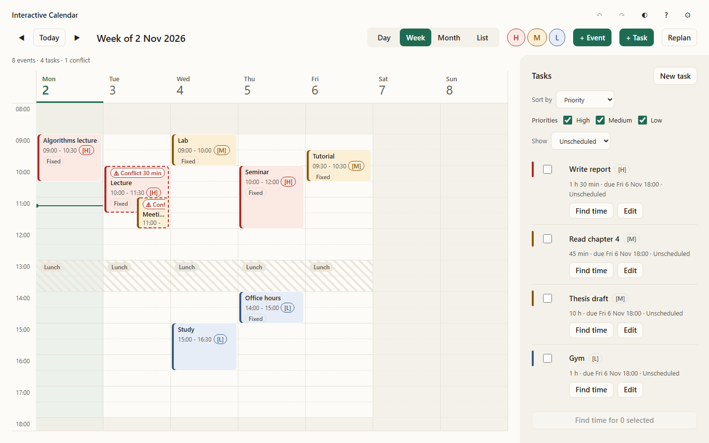

# Interactive Calendar and Intelligent Time Planner

A browser-based week planner that detects every scheduling conflict, finds free time for your tasks and explains _why_ each suggested slot fits.

**▶ Live app:** [int-calendarfeature-creatures.vercel.app](https://int-calendarfeature-creatures.vercel.app). Nothing to install; all data stays in your browser.



## Team

**Feature Creatures** · Project 4 of CS-3810 _Design Practices in Computer Science_, Ashoka University, Monsoon 2026

| Member           | Roll number |
| ---------------- | ----------- |
| Samar Baskar     | 1020241699  |
| Divyam Chaudhary | 1020221520  |

## What it does

- **Calendar.** Create, edit, drag, resize and delete events in Day, Week, Month and List views.
  - Each event has a category, a priority (High, Medium or Low) and an optional _flexible_ window. New events start Fixed; choose Flexible when the planner may move them.
- **Categories.** Create, rename, recolour and delete categories in Settings → Categories, or create one inline in either item dialog. Each change is undoable. Used categories show their event/task counts when deletion is blocked. Choose from twelve swatches or a custom colour checked for contrast and distinctness. Category chips beside H/M/L filter the calendar; Reset filters restores both. Tasks and conflict detection keep all their data.
- **Conflict detection.** Every pair of overlapping events is found automatically after each change.
  - Each conflict shows which events overlap, the exact overlap (e.g. 11:00–11:30) and its length in minutes.
  - Back-to-back events do not count as conflicts.
  - Upcoming conflicts drive the count; **Past** starts collapsed and keeps read-only overlap details. Ended events and past days are muted, while each day has a faint current-time guide. Counts and warnings refresh as time passes.
- **Conflict resolution.** _Suggest alternatives_ proposes free slots for the event that is better to move, closest to its original time first.
  - Fixed events require **Allow moving this event** and a temporary date range; applying an option keeps the event Fixed.
- **Calendar lock.** Lock the timeline to browse and drag the time grid to pan without changing events. **K** toggles it; event dialogs, + Event and deliberate Apply actions remain available. Existing calendars start locked on reload. Unlocked fixed moves/resizes ask for the proposed destination or duration.
- **Calendar / List.** List always shows a week; return to Calendar to restore its last Day, Week or Month view. **L** toggles the two.
- **Best-time finder.** Tasks have a duration, a priority and a window, such as "90 minutes, sometime this week".
  - Review named top picks and time chips grouped by day. Rank by (earliest, best fit or priority-aware) preselects a pick; chips stay in time order. Show N more expands a day, and Details reveals the window, buffer and selected slot's explanation.
  - Every slot says which gap it came from and what bounds it. When nothing fits, the app says why and shows the largest gap it found.
- **Several tasks at once.** Selected tasks are offered one at a time, highest priority first. Each search sees the slots you already accepted.
- **Replan.** For a chosen week, the app proposes two rearrangements of your flexible events: _Minimal change_ and _Balanced week_.
  - Each plan lists every move with a reason, plus before/after metrics. Apply one or neither.
  - Unresolved future or ongoing problems Replan won't move are listed with the reason. Entirely past problem overlaps are omitted; Already started describes a currently running event.
- **Your rules.** Working days and hours, a buffer between events, and barred slots such as lunch. Ongoing/future barred overlaps are flagged separately from conflicts; past overlaps have no tag, row or settings warning. Keep here records an undoable exception for that slot; time edits or slot time/day changes clear it. New overlapping barred slots are rejected.
- **Comfort features.** Undo/redo, JSON export/import, six built-in sample calendars, light and dark themes, keyboard shortcuts (press **?**), and screen-reader and keyboard support.

Nothing changes without your say-so: suggestions and plans are previews until you click **Apply**.

## Try it in two minutes

1. Open the [live app](https://int-calendarfeature-creatures.vercel.app) and click **Load sample week**.
2. **Conflicts.** Look at Tuesday: _Lecture_ and _Meeting_ are flagged _Conflict 30 min_, and the right panel lists the overlap. Click **Suggest alternatives**, pick a slot and **Apply**. The conflict disappears.
3. **Finding time.** In **Tasks**, click **Find time** on _Write report_. Switch Rank by between _Earliest fit_, _Best fit_ and _Priority-aware_ to change the selected pick. Choose a pick or a time chip, open **Details** for its explanation or buffer override, then **Apply selected**. Alternatives uses the same layout with Closest, Same day and Lightest day picks.
4. **A task that can't fit.** Try **Find time** on _Thesis draft_, a 10-hour task. Lunch splits each day into four-hour stretches, so the app explains that the task can never fit, rather than just finding no slot.
5. **Replan.** Click **Replan**, then **Compute plans**, and compare the two plans. Apply one and press **Undo** to revert it in a single step.
6. **Your own events.** Drag across empty time to create an event, or drag an existing event onto another to create a conflict.

More presets (overlap cluster, midnight crossing, fully booked day, a 5,000-event stress test) are under **Settings → Data → Load sample calendar**. Loading a sample replaces your current data, so export first if you want to keep it.

Existing browser data upgrades automatically to database v3 with events, tasks, settings and the multi-tab revision preserved. New JSON exports use version 2 and include categories; version 1 backups still import.

Turn off **Use working hours** in Settings to let Find time, alternatives and Replan use whole local days, including nights and weekends. Barred slots still apply. Saved working-time preferences are disabled and retained; task/search-hour choices and non-working shading return when you switch it back on.

## Run it locally

You need Node.js 22 and npm.

```bash
npm ci
npm run dev      # development server; open the URL it prints
npm run build    # production build into dist/
npm run preview  # serve that build locally
```

On Windows PowerShell setups that block npm's script wrappers, use `npm.cmd` and `npx.cmd`.

## How it works

The app is a static React + TypeScript site with three layers. Each layer may only call the one below it, and ESLint rules enforce that.

| Layer                                 | What it does                                                                                                                                                                                     |
| ------------------------------------- | ------------------------------------------------------------------------------------------------------------------------------------------------------------------------------------------------ |
| **UI** (React, FullCalendar, zustand) | Draws the calendar and dialogs, and turns clicks and drags into commands. FullCalendar only renders; it makes no scheduling decisions.                                                           |
| **Engine** (plain TypeScript)         | Validates every command, runs four pipelines (event changes, conflict resolution, task scheduling, replan) and keeps undo history. Its algorithms are pure functions with no UI or storage code. |
| **Storage** (Dexie / IndexedDB)       | Saves events, tasks and settings in the browser, behind an interface that also has an in-memory version for tests.                                                                               |

**Key algorithms.** Here N is the number of events, n the number in the searched window, m the number of free gaps and k the number of conflicting pairs.

- **Conflict detection: a sweep line with a min-heap.**
  - Events are kept sorted by start time. The sweep holds every still-running event in a heap ordered by end time, and drops each one once it has ended.
  - Every event still in the heap overlaps the new one, so all pairs are found in O(N log N + k), plus O(k log k) to order the output.
  - A simpler "running maximum end" sweep was considered and rejected: it misses pairs when three events overlap.
- **Free time: merge, then complement.**
  - Events in the window, widened by the buffer, are merged into busy blocks.
  - What remains of the working hours, after removing barred slots and the busy blocks, is the free gaps.
  - This takes O(log N + n) once the store is sorted, with no re-sorting.
- **Ranking: greedy choice over the gaps.**
  - Picker candidates include both fitting gap boundaries, every fitting half-hour start and the clamped original start for alternatives. Each retains its gap/boundaries, leftover, day load and distance. The selected criterion preselects a named pick. Replan keeps one candidate per gap and its original ranking.
  - This costs O(m log m).
- **Replan: a one-pass greedy.**
  - Flexible events are placed in priority order. Each one either keeps a valid spot or takes the best candidate for that plan.
  - It is fast and every move is explainable, but it is not guaranteed to be globally optimal.

The full algorithm descriptions, correctness arguments and complexity table are in [TECH_SPEC.md](docs/TECH_SPEC.md) (§8 and §10). The data representation of events, tasks, priorities and intervals is in TECH_SPEC §5 and [PROJECT_SCHEMA.md](docs/PROJECT_SCHEMA.md) §3.

**Limitations.**

- There is no backend, account system, sync or sharing; data lives in one browser.
- There are no recurring events.
- Several tasks are scheduled one at a time, not jointly optimised.
- The phone layout is best effort.

## Testing

The algorithms are the core of the project, so they are tested hardest:

- **Exact cases.** Hand-worked examples with exact expected results, such as "10:00–11:30 and 11:00–12:00 overlap from 11:00 to 11:30 for 30 minutes".
- **Brute-force oracles.** The fast algorithms are compared against deliberately simple, obviously-correct versions on thousands of random calendars.
- **Integration.** The engine is tested end to end with both storage implementations.
- **UI.** The interface is tested against the real engine, not a mock.
- **Browser automation** (Playwright). Real dragging, resizing and the main workflows run in Chromium.

Continuous integration runs these checks on every change to `main`.

**Latest results** (12 November 2026, after the peer bug fixes):

| Check                                      | Result                                                                                                                         |
| ------------------------------------------ | ------------------------------------------------------------------------------------------------------------------------------ |
| Unit, integration and UI tests             | 639 passing                                                                                                                    |
| Randomised oracle tests                    | 5 properties × 10,000 random calendars each, all passing                                                                       |
| Daylight-saving tests (New York time zone) | 7 passing                                                                                                                      |
| Browser tests (Chromium)                   | 25 passing; 125 of 125 runs passed when the suite was repeated 5 times (no flaky tests)                                        |
| Code coverage                              | 98.78% of lines and 94.23% of branches overall; 99.68% / 95.93% for the algorithms                                             |
| Performance                                | Conflict detection plus a slot search on a 5,000-event calendar: median 1.3 ms (target: under 100 ms)                          |
| Manual checks on the live site             | All five demo scripts passed; colour contrast and screen-reader announcements checked                                          |
| Independent code audit                     | 10 findings re-checked, then fixed with tests or deferred with reasons ([AUDIT.md](docs/extras/AUDIT.md))                      |
| Peer bug reports                           | 14 reports re-checked: 11 fixed with tests, 1 clarified, 1 by design, 1 invalid ([BUG_REPORTS.md](docs/extras/BUG_REPORTS.md)) |

**Reproduce the results.** Install dependencies with `npm ci`, then:

```bash
npm test                  # unit, integration and UI tests
npm run test:coverage     # the same, with a coverage report in coverage/index.html
npm run test:dst          # daylight-saving tests
npm run test:props:full   # randomised oracle tests at 10,000 cases each
npx playwright install chromium
npm run e2e               # browser tests (builds and serves the app itself)
npm run test:perf         # the 5,000-event performance check
```

Every test case, with its exact inputs and expected outputs, is listed in [TEST_PLAN.md](docs/TEST_PLAN.md). The file also has a table mapping each requirement to its tests, the manual checklists and the demo scripts with their recorded outcomes. Timings depend on hardware; coverage and test counts should match.

## Samples and demonstrations

- **Sample calendars.** [docs/samples/](docs/samples/README.md) has six importable sample calendars: sparse week, back-to-back, overlap cluster, fully booked day, midnight crossing, and a 5,000-event stress test. Import them via **Settings → Data → Import JSON**, or load the same presets directly from the app.
- **Demo scripts.** Step-by-step scripts for event management, conflict detection, best-time finding, replanning and the extras are in [TEST_PLAN.md](docs/TEST_PLAN.md) §8, demos D1–D5.
- **Screenshots** (in [docs/screenshots/](docs/screenshots/)):

| View                    | Light                                                                                                                                                                                                                                                                  | Dark                                                                                                                                                                                                                                                               |
| ----------------------- | ---------------------------------------------------------------------------------------------------------------------------------------------------------------------------------------------------------------------------------------------------------------------- | ------------------------------------------------------------------------------------------------------------------------------------------------------------------------------------------------------------------------------------------------------------------ |
| Week                    | [1440 px](docs/screenshots/week-light-1440.png) · [1280 px](docs/screenshots/week-light-1280.png) · [1024 px](docs/screenshots/week-light-1024.png)                                                                                                                    | [1440 px](docs/screenshots/week-dark-1440.png) · [1280 px](docs/screenshots/week-dark-1280.png) · [1024 px](docs/screenshots/week-dark-1024.png)                                                                                                                   |
| Past time (expanded)    | [1440 px](docs/screenshots/past-time-expanded-light-1440.png) · [1280 px](docs/screenshots/past-time-expanded-light-1280.png) · [1024 px](docs/screenshots/past-time-expanded-light-1024.png)                                                                          | [1440 px](docs/screenshots/past-time-expanded-dark-1440.png) · [1280 px](docs/screenshots/past-time-expanded-dark-1280.png) · [1024 px](docs/screenshots/past-time-expanded-dark-1024.png)                                                                         |
| Categories              | [1440 px](docs/screenshots/categories-light-1440.png) · [1280 px](docs/screenshots/categories-light-1280.png) · [1024 px](docs/screenshots/categories-light-1024.png)                                                                                                  | [1440 px](docs/screenshots/categories-dark-1440.png) · [1280 px](docs/screenshots/categories-dark-1280.png) · [1024 px](docs/screenshots/categories-dark-1024.png)                                                                                                 |
| Find time (slot picker) | [1440 px](docs/screenshots/task-suggestions-light-1440.png) / [1280 px](docs/screenshots/task-suggestions-light-1280.png) / [1024 px](docs/screenshots/task-suggestions-light-1024.png)                                                                                | [1440 px](docs/screenshots/task-suggestions-dark-1440.png) / [1280 px](docs/screenshots/task-suggestions-dark-1280.png) / [1024 px](docs/screenshots/task-suggestions-dark-1024.png)                                                                               |
| Find time Details       | [1440 px](docs/screenshots/task-suggestions-details-light-1440.png) / [1280 px](docs/screenshots/task-suggestions-details-light-1280.png) / [1024 px](docs/screenshots/task-suggestions-details-light-1024.png)                                                        | [1440 px](docs/screenshots/task-suggestions-details-dark-1440.png) / [1280 px](docs/screenshots/task-suggestions-details-dark-1280.png) / [1024 px](docs/screenshots/task-suggestions-details-dark-1024.png)                                                       |
| Alternatives Details    | [1440 px](docs/screenshots/fixed-alternatives-details-light-1440.png) / [1280 px](docs/screenshots/fixed-alternatives-details-light-1280.png) / [1024 px](docs/screenshots/fixed-alternatives-details-light-1024.png)                                                  | [1440 px](docs/screenshots/fixed-alternatives-details-dark-1440.png) / [1280 px](docs/screenshots/fixed-alternatives-details-dark-1280.png) / [1024 px](docs/screenshots/fixed-alternatives-details-dark-1024.png)                                                 |
| Fixed-event search      | [off](docs/screenshots/fixed-alternatives-off-light-1440.png) · [1440 px](docs/screenshots/fixed-alternatives-on-light-1440.png) · [1280 px](docs/screenshots/fixed-alternatives-on-light-1280.png) · [1024 px](docs/screenshots/fixed-alternatives-on-light-1024.png) | [off](docs/screenshots/fixed-alternatives-off-dark-1440.png) · [1440 px](docs/screenshots/fixed-alternatives-on-dark-1440.png) · [1280 px](docs/screenshots/fixed-alternatives-on-dark-1280.png) · [1024 px](docs/screenshots/fixed-alternatives-on-dark-1024.png) |
| Replan with both plans  | [light](docs/screenshots/replan-light.png)                                                                                                                                                                                                                             | [dark](docs/screenshots/replan-dark.png)                                                                                                                                                                                                                           |
| Event dialog            | [light](docs/screenshots/event-dialog-light-1440.png)                                                                                                                                                                                                                  | [dark](docs/screenshots/event-dialog-dark-1440.png)                                                                                                                                                                                                                |
| Empty state             | [light](docs/screenshots/empty-light.png)                                                                                                                                                                                                                              | [dark](docs/screenshots/empty-dark.png)                                                                                                                                                                                                                            |
| Settings                | [1440 px](docs/screenshots/settings-light-1440.png) · [900 px](docs/screenshots/settings-light-900.png)                                                                                                                                                                | [1440 px](docs/screenshots/settings-dark-1440.png) · [900 px](docs/screenshots/settings-dark-900.png)                                                                                                                                                              |

## Documentation

| Document                                     | Read it for                                                                                       |
| -------------------------------------------- | ------------------------------------------------------------------------------------------------- |
| [PROJECT_SCHEMA.md](docs/PROJECT_SCHEMA.md)  | What the app does: requirements, error handling, exact scheduling rules, domain model and UX      |
| [TECH_SPEC.md](docs/TECH_SPEC.md)            | How it is built: architecture, data types, algorithms with complexity, storage and the build plan |
| [TEST_PLAN.md](docs/TEST_PLAN.md)            | How it is verified: every test case, traceability, manual checks and demo scripts                 |
| [AUDIT.md](docs/extras/AUDIT.md)             | An independent review of the finished code, and how each finding was resolved                     |
| [BUG_REPORTS.md](docs/extras/BUG_REPORTS.md) | The fourteen peer bug reports: each verdict, its evidence and the fix                             |
| [PROGRESS.md](docs/progress/PROGRESS.md)     | The development log: each work item, its test results and the decisions made along the way        |
| [AUDIT_2.md](docs/extras/AUDIT_2.md)         | The binding Round 2 redesign decisions and implementation plan                                    |
| [PROMPTS.md](docs/extras/PROMPTS.md)         | The prompts that shaped the project; [Round 2 session prompt](docs/extras/PROMPT_ROUND_2.md)      |

**Deviations from our earlier design assignments.** These documents replace our three design assignments, which were written separately before any code existed. Merging them meant settling where they disagreed, and a few changes came from real constraints:

- The course requires a hosted URL, so the app became a static website. Browser storage (IndexedDB) replaced the SQLite database we had planned for a locally run app.
- Conflict detection uses a heap-based sweep. The simpler sweep in the early assignments misses some overlapping pairs.
- Events are stored in plain sorted arrays. A planned binary-search-tree upgrade was unnecessary at realistic sizes and was dropped.
- Features the assignments described only loosely (Replan, scheduling several tasks, priority-aware ranking) were given exact rules.

Each deviation is listed with its reason in [PROJECT_SCHEMA.md §9](docs/PROJECT_SCHEMA.md#9-deviations-from-the-submitted-assignments). Smaller decisions made during implementation are in the decisions log of [PROGRESS.md](docs/progress/PROGRESS.md) and in each document's change log.

## How this project was built (AI-assisted development)

Our course permits AI for any task, on one condition: each student must be able to explain every line in an oral examination.

- **What the team did.** We wrote the requirements and design, made every product decision, reviewed the work, tested the live app and reported problems.
- **What the AI agents did.** Most of the code was written by AI coding agents (OpenAI Codex and Anthropic Claude Code). They worked one at a time, handing over through the repository.
- **Why there are guardrails.** To keep code from several agents consistent, correct and explainable, we built a set of rules into the repository. These files show how:

```text
.
├── AGENTS.md                         # the rules every agent followed in every session
├── CLAUDE.md                         # points Claude Code at AGENTS.md
├── .agents/skills/disciplined-coding/SKILL.md   # our coding standard (the same file is in .claude/skills/)
├── .claude/settings.json             # commands agents could run; pushing and deploying were reserved for humans
└── docs/
    ├── PROJECT_SCHEMA.md, TECH_SPEC.md, TEST_PLAN.md   # the specification agents built against
    ├── progress/PROGRESS.md          # the work-item log and handover notes between sessions
    └── extras/                      # audits, peer reports, prompts and Round 2 planning evidence
```

What these rules meant in practice:

1. **The specification came first.** Agents built against the three documents above, not a chat history. The work was split into 39 small work items, each with a list of tests that must pass before it counts as done.
2. **Every function carries a contract.** Our coding standard requires a written precondition and postcondition (`PRE` / `POST`) above every function and component, and an `INVARIANT` above every loop, before the code is written.
   - Open any file in `src/engine/algorithms/` to see them.
   - They make the reasoning reviewable, and they are what we study from for the oral exam.
3. **Tests come before code.** Algorithm and engine code was written test-first against the exact values in TEST_PLAN.md, then cross-checked by the randomised oracle tests.
4. **The architecture is enforced, not just described.** Lint rules stop the algorithms from importing UI, storage or date libraries, and coverage thresholds and CI stop regressions.
5. **Humans stayed in the loop.**
   - We tested every milestone on the live site.
   - A separate AI audit reviewed the code; each confirmed finding was fixed with a failing test first.
   - The full history is visible: each work item has its own branch, merged into `main` with its own commits.
